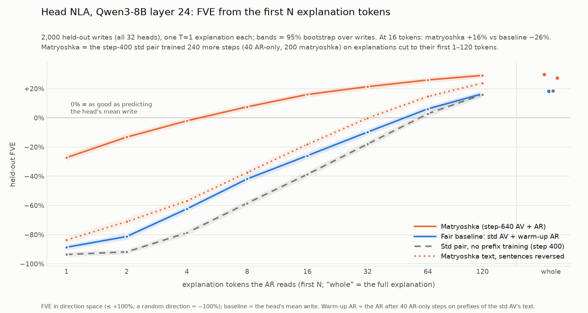

# Head-contribution NLA on Qwen3-8B: results

What we found, by question. Each section gives the numbers and what they mean, and points to the doc or script
with the details. For the chronological story (what was run, when, what broke), see
`docs/head_nla_session_log.md`.

## The system and how it is scored

**What is explained.** At one token, attention head h of a layer adds a **write** to the residual stream:
w_h = W_O[:, 128h:128h+128] · z_h, where z_h is the head's 128-d attention output. The 32 writes of a layer
sum exactly to the attention block's output.

The NLA sees the **deviation** v = O_h(z_h − z̄_h)/rms_h: the write minus the head's average write over a
large corpus, normalized per head and capped at norm 4.

**The two models.**
- **AV (verbalizer):** Qwen3-8B + LoRA. The vector is injected at a marker token, norm-matched to the hidden
  state, so only its direction matters. A fixed prompt that **does not name the head**. It writes a prose
  explanation.
- **AR (reconstructor):** Qwen3-8B truncated to layer + 1 blocks, with a linear value head and LoRA. It reads
  `Attention head L24Hh: <explanation>` and predicts the vector.
- **Training:** SFT on teacher explanations, then GRPO. The reward is reconstruction, and the AR is
  co-trained.

**Metrics.** Both vectors are rescaled to norm √d, so error = 2 − 2·cos.
- **Cosine** between the reconstruction and the true write: 0 = random direction, 1 = perfect.
- **Skill** = (cos − 0.06) / 0.94. 0.06 is what pointing at the head's mean write direction gets, so
  0% = "knows only which head".
- **Direction-space FVE** = 1 − error / error of the head's mean write.
  - The prediction is renormalized but the mean is not, so FVE > 0 needs cos above about 0.5. The
    crossover is 1 − e/2, where e is the mean write's error; it is 0.41–0.66 per site (0.50–0.57 per head).
    FVE below 0 at a moderate cos is a property of the metric, not a sign the model is worse than guessing.
  - A random direction scores about −100%, and the best possible is +100%.
- **Held-out data:** 6,360 eval rows of L24 (32 heads, documents no model trained on) for the standard
  checks; 2,000 of them for the matryoshka sweep.
- **Shuffled control:** the AV describes a different write of the same head, scored against the true
  write.

**Scope.** Almost everything is **layer 24, all 32 heads**. Qwen3-8B has 8 KV heads, so heads 4k…4k+3
share keys and values.

## 1. Can an 8B model describe a head's write at all? (warm start)

**Attention-based Claude descriptions** (first attempt): a quick SFT test on 64 heads of L12 and L24, 200
examples per head.
- The AR learned a little: FVE 0.019 vs −0.025 on shuffled descriptions.
- **The AV did not beat a shuffled control.**
- That approach was also against the rules: the teacher saw attention and context. It was dropped.

**Soft-token readouts** (`nla/datagen/heads/soft_token.py`): inject the write at its own layer in a fixed
prompt and read what the model predicts. This is a function of the write alone.
- Diagnostics on one head per layer, held-out probe FVE at 2,400 examples:

  | Head | Vocab projection (lens) | Best short-token readout | Model's hidden state (ceiling) |
  |---|---|---|---|
  | L6H27 | 0.24 | 0.32 | 0.62 |
  | L12H20 | 0.32 | 0.27 | 0.75 |
  | L18H16 | 0.02 | 0.05 | 0.70 |
  | L24H8 | 0.16 | 0.17 | 0.77 |
  | L30H9 | 0.15 | 0.17 | 0.55 |

- The model's own hidden state after reading the write carries 55–77%. Short token lists carry far less,
  and they vary a lot by head and layer.

**Haiku explanations written from the readouts, never mentioning tokens.** About 25 prompt variants were
tried for $6.88; L24 used 1,500 examples per head.

| Probe features (held-out FVE, mean over 32 heads) | 200 / head | All (~1,490) |
|---|---|---|
| avg16 readout | 0.060 | 0.159 |
| lens readout | 0.063 | 0.172 |
| explanation (TF-IDF) | 0.004 | 0.067 |
| explanation (embedding) | 0.009 | 0.075 |
| hidden state (ceiling) | 0.383 | 0.737 |
| shuffled / empty | −0.015 | −0.002 |

- Explanations keep 42–47% of the readouts' information. They are real rewrites: a median of 10% of their
  content words are copied from the readouts. Their curve was still steep when the data ran out.

**SFT warm start, two contracts.**
- **Raw-magnitude** (first): the AR got FVE 0.063 on gold and 0.049 on the AV's text (−0.067 shuffled).
- **Standard NLA recipe** (norm-matched injection, direction-only loss, 1 epoch): the AV + AR pair reaches
  cos 0.095 greedy / 0.071 at T=1, against 0.009 shuffled. Gold reaches 0.116.
  - True − shuffled is +0.086 cos [0.082, 0.089]; positive on 30/32 heads, significant on 28.
  - The signal is concentrated in about 9 heads: H16–19, H25–26, H5, H13, H24.

**Takeaway.** A write-only warm start works, but it is weak: about 1–4% skill. Most of what makes the NLA
useful comes from RL.

## 2. What does RL buy? (standard recipe, 400 GRPO steps)

Doc: `docs/head_nla_l24_std_plan.md`. Recipe: 64 prompts × 8, AV lr 1e-4, AR co-trained at 8e-5, k3 KL 0.01
to the SFT AV, reward 2·cos − 2, one H100. An earlier run on raw MSE with magnitude-preserving injection was
stopped at step 44: its reward was dominated by batch noise.

| AV → AR (held-out, 6,360 rows) | Decoding | Cos, true write | Skill | Cos, shuffled | Gold → AR |
|---|---|---|---|---|---|
| SFT → SFT | T=1 | 0.071 | 1% | 0.006 | 0.116 |
| **RL step 400 → RL step 400** | **T=1** | **0.596** | **57%** | 0.000 | 0.231 |
| RL step 400 → RL step 400 | greedy | 0.551 | 52% | 0.004 | 0.231 |
| RL AV → frozen SFT AR | greedy | 0.178 | 13% | 0.004 | 0.117 |
| SFT AV → RL AR | greedy | 0.198 | 15% | 0.017 | 0.231 |

- **The gain is large and specific to the write.** FVE goes from −87% (SFT) to +19% (RL), +107 points. RL
  beats SFT on 99.7% of rows and on every head (+41 to +146 points). The shuffled control stays at 0.
- **Training curve** (held-out cosine): 0.08 at step 0 → 0.34 (100) → 0.47 (200) → 0.55 (300) → 0.61 (390).
- **Per head:** mean FVE ranges from H3 −59% to H18 +63%; 24/32 heads are above 0%
  (`docs/head_nla_l24_std_fve_by_head.png`). Distribution over examples:
  `docs/head_nla_l24_std_fve_distribution.png`.
- **Both models improved on their own** (about 2× each), but the pair is far better than either alone. The
  1-epoch SFT AR reads any text poorly: 0.15 for both gold and RL text.
- **Side effects:**
  - At T=1, 93% of explanations quote tokens (SFT: 0%). They grow from 34 to 114 words, 79% contain stray
    markup (`
`), and openings are templated: 66% of greedy outputs start "Statements about…" (10% of
    T=1 doc-viewer outputs).
  - KL to the SFT AV settled at 1.1–1.4 nats per token. The β = 0.01 term was about 1% of the signal.
  - Greedy outputs run to the 256-token cap 74% of the time at step 400. T=1 is the reliable decoding.
- **The quotes and markup are not what earns the reward.** Within a head, explanations without quotes score
  higher (cos 0.73 vs 0.59).

## 3. Is the information in the words, or a private code between the two models?

**In the words** (`scripts/heads_private_code_test.py`, 1,454 doc-viewer sites). Rewrite each RL explanation
and see how much of its gain over no text the RL AR still recovers:

| Version read by the RL AR | Retention |
|---|---|
| Original RL explanation | 100% |
| Markup and quote marks stripped | 99% |
| **Haiku paraphrase** (new wording and structure) | **97%** (gold under the same treatment: 97%) |
| Quoted spans deleted | 95% |
| Words shuffled | 92% |
| Content words only | 91% |
| First sentence only | 69% |
| **Content words masked, form kept** | **2%** |

- The paraphrase keeps at least 88% on every head. Per-site scores track the originals (r = 0.94).
- Occlusion puts 62% of the weight on content words, 12% on quoted words (3.5% of tokens) and 1% on markup.

## 4. How faithful are the explanations?

- **Before RL, faithfulness predicts reconstruction.** A blinded Sonnet judge scored 823 rows for
  faithfulness to the write's readouts (1–5): gold 4.06, AV 2.69, shuffled control 1.80. More faithful AV
  explanations reconstruct better. The judge agrees with hand ratings (ρ 0.89).
- **RL did not make them more faithful.** Judged against the readouts: RL 1.99 vs SFT 1.98 (gold 4.06,
  control 1.28). With context and attended tokens shown, RL scores 1.58 vs SFT 1.59.
  - Within a text type, faithfulness and cosine correlate (ρ ≈ +0.41), but 33% of RL rows have cos ≥ 0.6
    and faithfulness ≤ 2.
  - The most faithful heads are H16–19, H5 and H26.
- **What the RL text adds is mostly content the readouts don't show:** the document's topic, and quoted
  tokens the head attended to (section 6). The write does carry these.

## 5. Do the explanations separate heads, and does the AV know which head it is reading?

- **The AV is not told the head, but the vector identifies it.** Each head's write lies in its own 128-d
  output subspace. Picking the subspace that holds most of the vector recovers the head for **100%** of
  7,680 vectors (median share 1.0 in its own subspace vs 0.44 for the best other head).
- **The text carries head identity.** A 32-way classifier, held out by document (chance 3.1%):

  | Text | Accuracy |
  |---|---|
  | RL | **42%** |
  | Gold | 33% |
  | SFT | 9.5% |

- **GQA siblings (H16–19, which share keys and values) can be told apart from text.**
  - Blinded Sonnet matching: RL 79%, against 45% for a shuffled-position control (SFT 50%, gold 100%).
  - TF-IDF classifier on RL text: 55% (chance 25%).
- **Should a GQA group be treated as one head? No.** Same-group writes share subspace 5× more than heads
  from different groups (top-16 overlap 0.098 vs 0.013), but at the same token their signed cosine
  averages −0.03. The KV group explains 67% of per-head FVE variance, so it is useful for analysis but not
  as the unit to train on.

## 6. Do quoted terms name what the head reads?

`scripts/heads_quote_attention.py` checks every token × head of the 4 doc-viewer documents (about 38k
explanations per source). The control: the same quote checked against the other 31 heads' attention at
the same token.

| | Std RL | Matryoshka | Gold / SFT |
|---|---|---|---|
| Explanations with a quote | 89% | 42% | under 1% |
| Quote = current token | 3.5% | 11% | — |
| Quote in the head's top-5 attended (sink excluded) | 8.8% (other heads: 5.0%) | 19% (other heads: 11%) | — |
| Quote not in the context at all | **75%** | **65%** | — |
| Attention mass on in-context quoted tokens: this head vs other heads' mean | 0.067 vs 0.021 (**3.2×**) | 0.144 vs 0.030 (**4.8×**) | — |
| This head beats the median other head | 68% | 76% (first 16 tokens: 86%) | — |

The matching rule is loose: a quote matches a context token when any non-stopword word of the quote equals
it, or one contains the other (≥ 4 characters). The attention-mass rows are robust to that choice; the
"current token" and "not in context" rows are not. With strict matching (the whole quote equals 1–4
consecutive context tokens):
- quote = current token: 2.0% (std) / 3.6% (matryoshka);
- not in the context: 88% / 92%;
- mass ratio: 3.0× / 4.8×;
- beats the median other head: 70% / 86%.

The first-16-token figure rests on about 1,100–1,500 quotes, because short prefixes rarely quote.

- **The write carries the identity of the tokens the head attends to, and the AV reads it out.** The AV
  never sees the document, so this has to come from the write. The effect is strongest on H0, H7, H22, H5,
  H13, H15 and H6 (3–4× other heads); H0 and H7 quote the current token most (self-attending heads). For
  H1, H3, H4, H8 and H21 it is at chance.
- **Most quotes are associations, not text.** They are not next-token predictions either: 1% match the
  next 5 tokens, against 0.4% for a random 5-token window.
- An earlier count on the std run's greedy outputs agrees: content-word quotes match an attended token
  14.8% of the time (chance 3.0%) and the current token 8.2% (chance 0.3%).

## 7. How much do the explanations add beyond cheap baselines?

**Explanation-free guesses on the same FVE scale** (`scripts/heads_nla_baselines.py`, doc-viewer sites):

| Guess | Mean FVE | Heads where it beats RL |
|---|---|---|
| RL explanation | +23% | — |
| The head's other writes in the same doc, averaged | +14% | 10/32 (incl. H18, H24–27) |
| **The head's write at the previous token** | **+46%** | **27/32** |

- Writes change slowly from token to token, and 25% of a write's direction is the constant first-token
  (sink) contribution.
- **What the per-site text adds over the doc average** is largest on the self-attending heads H0 (+79
  points) and H7 (+56), and negative on the 10 heads that act as per-document topic encoders.

**Counterfactual relevance does not track explanation quality** (`scripts/heads_ablation_effects.py`).
Ablate one head at one token and re-run layers 24–35 in fp32 (bf16 noise of about 7e-4 nats swamps the
effects).
- "Relevant" here means next-token KL with the head ablated to its mean output. By that measure H27 is the
  most relevant head at 27% of tokens, and the top 5 heads carry 39% of all KL. By effect on later tokens,
  H0 tops instead (18% of tokens; H27 15%).
- H25/H26 help at the first mention of two English place names in the law document: "Br" → "igg" +0.50 nats
  from H25, "North" → "Lincoln" +0.46 from H26. At the repeat of "North Lincoln" they do nothing, so this is
  two sites, not a general place-name role.
- **ρ(relevance, RL FVE) = −0.04.** The heads the NLA explains best are not the ones that matter most for
  the output. Relevance falls with first-token attention (ρ −0.67) and rises with write norm (+0.68).

## 8. Mechanistic checks: does the NLA's story match what the head does?

**H18 / KV group 16–19** (`docs/head_nla_l24_h18_case_study.md`):
- **Mechanism:** a constant "off" write when attending to the first token (about 57% of attention), plus a
  document-domain broadcast. Every token's value already carries the domain, and the query sets how much
  is written.
  - Sink + one topic direction capture 75–90% of each write.
  - The four sibling heads read different sides of the same domain feature through their own O_h.
- **What the explanations got:** RL explanations name the right domain at 86–98% of sites (gold 54–87%).
  But they also say "crime" in 46–61% of non-crime rows, and they never mention the mechanism.
- **What the NLA contributed: little.** The head was chosen for its high FVE, and the mechanism came from
  attention, weights and the logit lens.

**Blind study on H29, H30, H13** (`docs/head_nla_l24_blind_study.md`). One agent had only matryoshka
explanations; another had only mechanistic evidence; a blind judge matched their anonymized summaries.

| Head | From explanations | From mechanism | Judge |
|---|---|---|---|
| H13 | entity and means categories tracking topic (tools, treatments, women, victims, agencies) | writes the **category noun** of the passage's entity ("woman", "officials", "tool", "medicines") | 5/5 |
| H29 | headline: "conditional doubt/absence"; minor: letters O, L, T, P | retrieves an earlier name and writes its **initial letter** (Ocoee → O, TMS → T) | 3/5 |
| H30 | headline: "skepticism"; minor: reporters, authorities, named people | reads "said"/"is"/"was" and writes the **speaker or subject** ("Kelly", "Ms", "Officials") | 3/5 |

- **The judge matched all 3 correctly** (confidence 95% / 78% / 78%). Mismatched pairs scored 1–2.
- **The H29/H30 headlines are the AV's reading of an empty write.** "Conditional doubt" openings are 100%
  in the top quarter of sink attention and 0–3% in the bottom quarter (ρ +0.78). Where these heads read
  real tokens, the explanations say "L … the first letter", "Reporter names … speaker reference".

## 9. Matryoshka: training the AV to put the important content first

Docs: `docs/head_nla_l24_matryoshka_plan.md`; figure `docs/head_nla_l24_mtry_fve_by_prefix.png`; examples
`docs/head_nla_l24_mtry_examples.md`.

**Method.** Continue from the std step-400 pair:
- 40 AR-only warm-up steps on truncated text;
- then 200 GRPO steps in which each group keeps its first L ~ U[1,120] tokens, and the AR scores and
  co-trains on that prefix;
- KL 0.03, tapered after token 16.

98% of the std AV's explanations are longer than 120 tokens, so almost every rollout is cut. Only the first
120 tokens are trained.

**Prefix sweep** (2,000 held-out writes; FVE by how many explanation tokens the AR reads):

| First N tokens | 1 | 4 | 16 | 64 | Whole |
|---|---|---|---|---|---|
| **Matryoshka** (step-640 AV + AR) | −27% | −2% | **+16%** | +26% | **+30%** |
| Fair baseline (std AV + warm-up AR) | −89% | −62% | −26% | +6% | +18% |
| Std pair (step 400) | −94% | −79% | −39% | +3% | +18% |
| Matryoshka text, sentences reversed | −84% | −57% | −18% | +15% | +27% |

- **Big gains at every length.** Matryoshka − baseline is +60 / +42 / +20 / +11 points at 4 / 16 / 64 /
  whole (95% CIs about ±2).
  - 16 matryoshka tokens about match a whole std explanation (cos 0.582 vs 0.594).
  - Whole explanations also improved: on the standard checks, cos goes 0.596 → **0.650**, true − shuffled
    1.199 → 1.302, and a text-only probe 0.134 → 0.174.
- **It is real frontloading.** Reversing the matryoshka text's sentences costs 34 points at 16 tokens but
  only 2 at whole. For std text, reversal costs 6.
- **At short prefixes the gain is in the AV, not just the AR.** The unchanged step-400 AR, which never saw
  prefixes or matryoshka text, reads matryoshka prefixes far better: cos 0.176 vs 0.036 at 1 token, 0.493 vs
  0.309 at 16.
- **For whole explanations it is mostly the AR.** The same fixed step-400 AR reads whole matryoshka texts at
  cos 0.605 vs 0.594 for std texts; the matryoshka AR reads them at 0.650. So most of the whole-text gain
  (0.596 → 0.650 above) comes from the co-trained reader. Every whole-text comparison in this section
  (and "Matryoshka − RL" in the doc viewer) compares pairs, each text read by its own AR. The AR improved little after its warm-up: it reads std text at 16 tokens with cos 0.367 vs 0.373.
- **What the text looks like.** Openings became "Topic: …" headlines ("Negation and uncertainty:",
  "American federal institutions:").
  - Explanations still close properly: 98.3% end with the closing tag, even though endings were never
    trained.
  - The tails degrade further into quoted-token lists, since nothing past 120 tokens is rewarded.
  - KL to the SFT AV rose from 1.27 to about 1.6.
- **Doc viewer** (every token × head, 4 documents): mean FVE goes from 25 / 15 / 21 / 31% to
  **37 / 28 / 32 / 43%**, and matryoshka's first 16 tokens beat the std text's first 16 tokens on every
  document (cos 0.59–0.67 vs 0.40–0.49).

## 10. Overall assessment

**What works:**
- **A write-only head NLA can be trained.** After RL its reconstructions reach held-out cosine 0.60 with the
  true write (skill 57%), and 0.65 after matryoshka (skill 63%). Most of that last step is the matryoshka AR:
  read by the step-400 AR, the matryoshka text scores 0.605.
- **The information is in the words.** It survives paraphrase, it lets anyone tell the heads (and GQA
  siblings) apart, and its in-context quotes point at what the head actually reads, 3–5× above other heads.
- **Matryoshka frontloading works and is cheap** (about $17). The first 16 tokens carry what used to need
  the whole explanation.
- **The explanations recover what a head writes, when it writes something.** In a blind test they recovered
  H13's entity categories, H29's name initials and H30's speaker identities.

**What doesn't:**
- **It does not supply mechanism.** The explanations never say which tokens are read, when the head fires,
  or what it changes downstream. That came from attention, weights and ablations.
- **Cheap baselines are strong.** The previous token's write beats the RL NLA on 27/32 heads (the
  matryoshka NLA on 21/32), and the doc mean beats the RL NLA on 10/32. Relevance to the output is
  unrelated to FVE.
- **Faithfulness, as judged against the write's readouts, did not improve with RL.** The text drifts into
  quotes, markup and templates. The KL penalty was too weak to stop it.
- **The "nothing here" failure mode.** Near-empty, sink-parked writes get a stock "conditional doubt"
  explanation. Averaging over all sites can therefore produce a confident but wrong account of a head.

**What to do next:**
- teach the AV an explicit "nothing here" or confidence output (e.g. a structured warm-start format with
  Activity / Confidence fields);
- filter or weight sites by write norm when using explanations;
- a higher KL, plus a frozen or independent reader to evaluate faithfulness;
- the multi-epoch AR retrain (prepared, never run);
- a layer scan before moving away from L24. Earlier diagnostics favour L6–L12 for text readouts.

## Index of results files

- **Std run results:**
  - `docs/head_nla_l24_std_plan.md`;
  - figures `docs/head_nla_l24_std_fve_distribution.png` and `head_nla_l24_std_fve_by_head.png`;
  - examples `docs/head_nla_l24_std_examples.md`;
  - HF `syvb/head-nla-qwen3-8b` under `l24/std_rl/` (results, faithfulness, viewers, private_code).
- **Earlier stages:** `docs/head_nla_data.md`, `docs/head_nla_l24_plan.md`, `docs/head_nla_l24_rl_plan.md`.
- **Mechanism:** `docs/head_nla_l24_h18_case_study.md` and `docs/head_nla_l24_blind_study.md`. The blind study's bundles and accounts are on HF under `l24/blind_study/`.
- **Matryoshka:** `docs/head_nla_l24_matryoshka_plan.md`, `docs/head_nla_l24_mtry_fve_by_prefix.png`,
  `docs/head_nla_l24_mtry_examples.md`. All public on HF:
  - the dataset `syvb/head-nla-qwen3-8b` under `l24/mtry/`: T=1 checks, raw sweep data, report, quotes vs attention, the matryoshka doc viewer and redacted logs;
  - the step-640 pair `syvb/head-nla-qwen3-8b-l24-mtry-{av,ar}`;
  - every checkpoint in `-l24-mtry-rl-ckpts`.
- **Process:** `docs/head_nla_session_log.md`.
