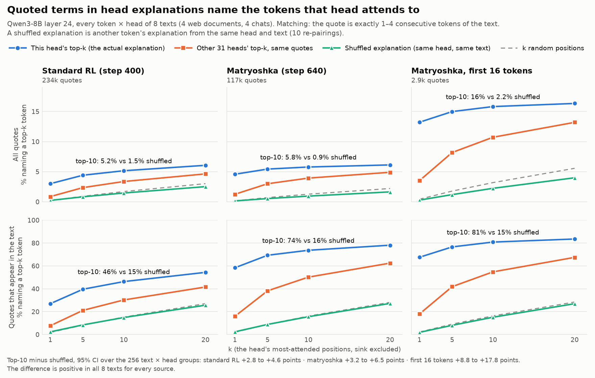
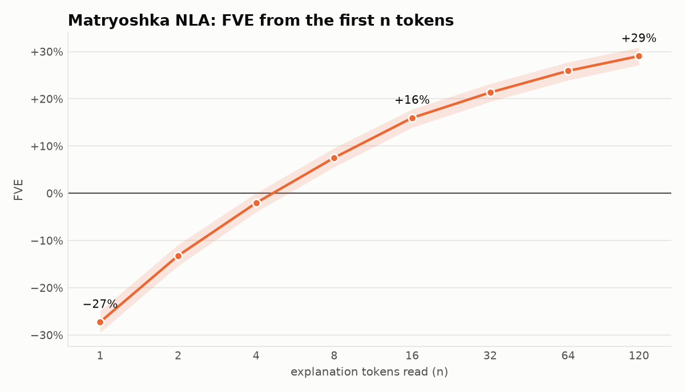
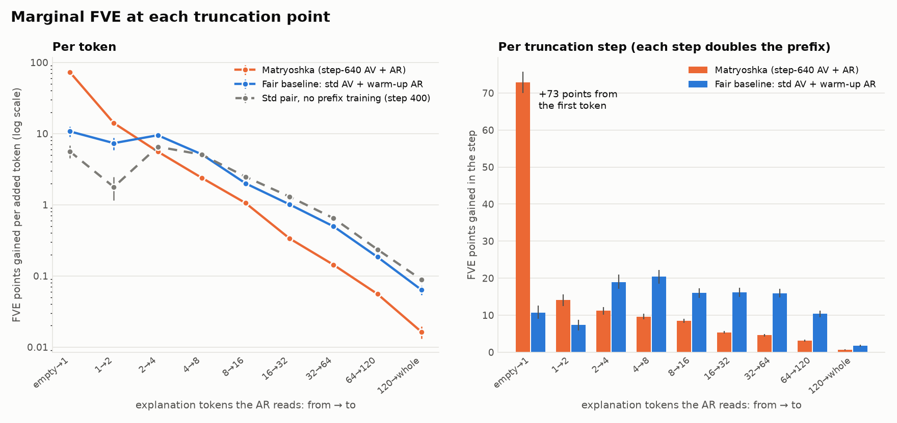
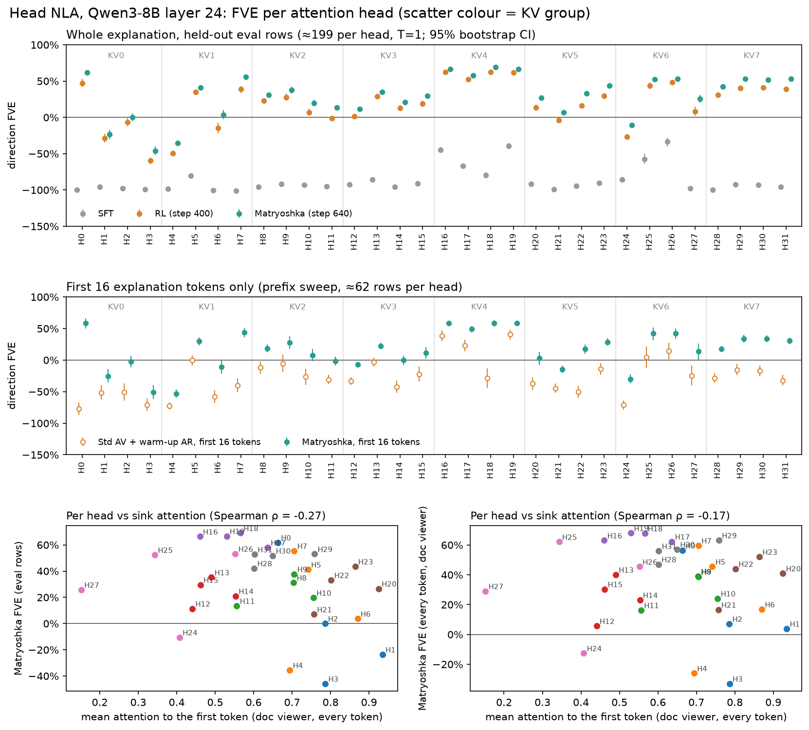
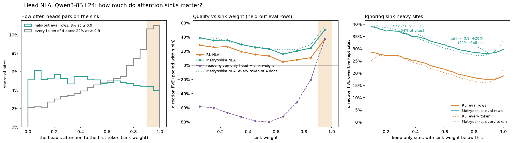
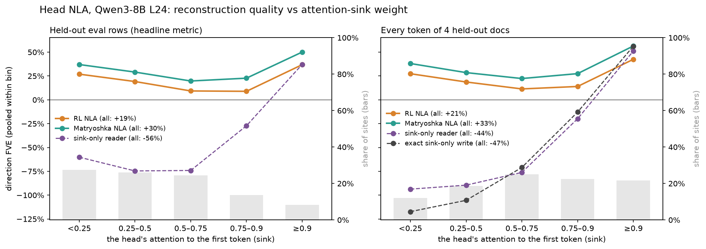

# Head-contribution NLA on Qwen3-8B: results

What we found, by question. Each section gives the numbers and what they mean, and points to the doc or script
with the details. For the chronological story (what was run, when, what broke), see
`docs/head_nla_session_log.md`.

## The system and how it is scored

**What is explained.** At one token, attention head h of a layer adds a **write** to the residual stream:
w_h = W_O[:, 128h:128h+128] · z_h, where z_h is the head's 128-d attention output. The 32 writes of a layer
sum exactly to the attention block's output.

The NLA sees the **deviation** v = O_h(z_h − z̄_h)/rms_h: the write minus the head's average write over a
large corpus, normalized per head and capped at norm 4.

**The two models.**
- **AV (verbalizer):** Qwen3-8B + LoRA. The vector is injected at a marker token, norm-matched to the hidden
  state, so only its direction matters. A fixed prompt that **does not name the head**. It writes a prose
  explanation.
- **AR (reconstructor):** Qwen3-8B truncated to layer + 1 blocks, with a linear value head and LoRA. It reads
  `Attention head L24Hh: <explanation>` and predicts the vector.
- **Training:** SFT on teacher explanations, then GRPO. The reward is reconstruction, and the AR is
  co-trained.

**Metrics.** Both vectors are rescaled to norm √d, so error = 2 − 2·cos.
- **Cosine** between the reconstruction and the true write: 0 = random direction, 1 = perfect.
- **Skill** = (cos − 0.06) / 0.94. 0.06 is what pointing at the head's mean write direction gets, so
  0% = "knows only which head".
- **Direction-space FVE** = 1 − error / error of the head's mean write.
  - The prediction is renormalized but the mean is not, so FVE > 0 needs cos above about 0.5. The
    crossover is 1 − e/2, where e is the mean write's error; it is 0.41–0.66 per site (0.50–0.57 per head).
    FVE below 0 at a moderate cos is a property of the metric, not a sign the model is worse than guessing.
  - A random direction scores about −100%, and the best possible is +100%.
  - **Why training starts far below 0%.** 0% means predicting the mean of the unit targets, and a reader with
    normalized output can't reach it. Its best constant output is the mean direction, which scores (ρ−1)/(1+ρ),
    where ρ is the length of the mean.
    - On our head targets, ρ is 0.076 (median per head), so the floor is −89% (−100% to −67% per head). The
      SFT pair (−87%) sits barely above it.
    - The raw head writes, before subtracting each head's mean write, are more clustered: ρ is 0.27 (0.13–0.65 per
      head), and the floor is −56%. Centering removes that head-only constant (§12). An earlier version of this
      line said raw writes were no more clustered (ρ 0.074); that came from a scaling bug, since fixed.
    - For the standard NLA's input (Qwen3-8B layer-24 residual), ρ is 0.66 and the floor only −20%. Much of
      that clustering is two outlier dimensions (mean |x| about 115, against a median of 1.7). Without them, ρ is
      0.34 and the floor −49%. Centered, the residual is even more spread out than the head writes (ρ 0.022).
    - The floor depends on sampling. Over every token of the 4 doc-viewer documents, where writes share a
      per-document part, ρ is 0.39 and the floor −44%. The NLA data has one site per document per head.
    - Source: `scripts/heads_mean_direction_floor.py` → `docs/head_nla_mean_direction_floor.json`.
- **Held-out data:** 6,360 eval rows of L24 (32 heads, documents no model trained on) for the standard
  checks; 2,000 of them for the matryoshka sweep.
- **Shuffled control:** the AV describes a different write of the same head, scored against the true
  write.

**Scope.** Almost everything is **layer 24, all 32 heads**. Qwen3-8B has 8 KV heads, so heads 4k…4k+3
share keys and values.

## 1. Can an 8B model describe a head's write at all? (warm start)

**Attention-based Claude descriptions** (first attempt): a quick SFT test on 64 heads of L12 and L24, 200
examples per head.
- The AR learned a little: FVE 0.019 vs −0.025 on shuffled descriptions.
- **The AV did not beat a shuffled control.**
- That approach was also against the rules: the teacher saw attention and context. It was dropped.

**Soft-token readouts** (`nla/datagen/heads/soft_token.py`): inject the write at its own layer in a fixed
prompt and read what the model predicts. This is a function of the write alone.
- Diagnostics on one head per layer, held-out probe FVE at 2,400 examples:

  | Head | Vocab projection (lens) | Best short-token readout | Model's hidden state (ceiling) |
  |---|---|---|---|
  | L6H27 | 0.24 | 0.32 | 0.62 |
  | L12H20 | 0.32 | 0.27 | 0.75 |
  | L18H16 | 0.02 | 0.05 | 0.70 |
  | L24H8 | 0.16 | 0.17 | 0.77 |
  | L30H9 | 0.15 | 0.17 | 0.55 |

- The model's own hidden state after reading the write carries 55–77%. Short token lists carry far less,
  and they vary a lot by head and layer.

**Haiku explanations written from the readouts, never mentioning tokens.** About 25 prompt variants were
tried for $6.88; L24 used 1,500 examples per head.

| Probe features (held-out FVE, mean over 32 heads) | 200 / head | All (~1,490) |
|---|---|---|
| avg16 readout | 0.060 | 0.159 |
| lens readout | 0.063 | 0.172 |
| explanation (TF-IDF) | 0.004 | 0.067 |
| explanation (embedding) | 0.009 | 0.075 |
| hidden state (ceiling) | 0.383 | 0.737 |
| shuffled / empty | −0.015 | −0.002 |

- Explanations keep 42–47% of the readouts' information. They are real rewrites: a median of 10% of their
  content words are copied from the readouts. Their curve was still steep when the data ran out.

**SFT warm start, two contracts.**
- **Raw-magnitude** (first): the AR got FVE 0.063 on gold and 0.049 on the AV's text (−0.067 shuffled).
- **Standard NLA recipe** (norm-matched injection, direction-only loss, 1 epoch): the AV + AR pair reaches
  cos 0.095 greedy / 0.071 at T=1, against 0.009 shuffled. Gold reaches 0.116.
  - True − shuffled is +0.086 cos [0.082, 0.089]; positive on 30/32 heads, significant on 28.
  - The signal is concentrated in about 9 heads: H16–19, H25–26, H5, H13, H24.

**Takeaway.** A write-only warm start works, but it is weak: about 1–4% skill. Most of what makes the NLA
useful comes from RL.

## 2. What does RL buy? (standard recipe, 400 GRPO steps)

Doc: `docs/head_nla_l24_std_plan.md`. Recipe: 64 prompts × 8, AV lr 1e-4, AR co-trained at 8e-5, k3 KL 0.01
to the SFT AV, reward 2·cos − 2, one H100. An earlier run on raw MSE with magnitude-preserving injection was
stopped at step 44: its reward was dominated by batch noise.

| AV → AR (held-out, 6,360 rows) | Decoding | Cos, true write | Skill | Cos, shuffled | Gold → AR |
|---|---|---|---|---|---|
| SFT → SFT | T=1 | 0.071 | 1% | 0.006 | 0.116 |
| **RL step 400 → RL step 400** | **T=1** | **0.596** | **57%** | 0.000 | 0.231 |
| RL step 400 → RL step 400 | greedy | 0.551 | 52% | 0.004 | 0.231 |
| RL AV → frozen SFT AR | greedy | 0.178 | 13% | 0.004 | 0.117 |
| SFT AV → RL AR | greedy | 0.198 | 15% | 0.017 | 0.231 |

- **The gain is large and specific to the write.** FVE goes from −87% (SFT) to +19% (RL), +107 points. RL
  beats SFT on 99.7% of rows and on every head (+41 to +146 points). The shuffled control stays at 0.
- **Training curve** (held-out cosine): 0.08 at step 0 → 0.34 (100) → 0.47 (200) → 0.55 (300) → 0.61 (390).
- **Per head:** mean FVE ranges from H3 −59% to H18 +63%; 24/32 heads are above 0%
  (`docs/head_nla_l24_std_fve_by_head.png`). Distribution over examples:
  `docs/head_nla_l24_std_fve_distribution.png`.
- **Both models improved on their own** (about 2× each), but the pair is far better than either alone. The
  1-epoch SFT AR reads any text poorly: 0.15 for both gold and RL text.
- **Side effects:**
  - At T=1, 93% of explanations quote tokens (SFT: 0%). They grow from 34 to 114 words, 79% contain stray
    markup (`
`), and openings are templated: 66% of greedy outputs start "Statements about…" (10% of
    T=1 doc-viewer outputs).
  - KL to the SFT AV settled at 1.1–1.4 nats per token. The β = 0.01 term was about 1% of the signal.
  - Greedy outputs run to the 256-token cap 74% of the time at step 400. T=1 is the reliable decoding.
- **The quotes and markup are not what earns the reward.** Within a head, explanations without quotes score
  higher (cos 0.73 vs 0.59).

## 3. Is the information in the words, or a private code between the two models?

**In the words** (`scripts/heads_private_code_test.py`, 1,454 doc-viewer sites). Rewrite each RL explanation
and see how much of its gain over no text the RL AR still recovers:

| Version read by the RL AR | Retention |
|---|---|
| Original RL explanation | 100% |
| Markup and quote marks stripped | 99% |
| **Haiku paraphrase** (new wording and structure) | **97%** (gold under the same treatment: 97%) |
| Quoted spans deleted | 95% |
| Words shuffled | 92% |
| Content words only | 91% |
| First sentence only | 69% |
| **Content words masked, form kept** | **2%** |

- The paraphrase keeps at least 88% on every head. Per-site scores track the originals (r = 0.94).
- Occlusion puts 62% of the weight on content words, 12% on quoted words (3.5% of tokens) and 1% on markup.

## 4. How faithful are the explanations?

- **Before RL, faithfulness predicts reconstruction.** A blinded Sonnet judge scored 823 rows for
  faithfulness to the write's readouts (1–5): gold 4.06, AV 2.69, shuffled control 1.80. More faithful AV
  explanations reconstruct better. The judge agrees with hand ratings (ρ 0.89).
- **RL did not make them more faithful.** Judged against the readouts: RL 1.99 vs SFT 1.98 (gold 4.06,
  control 1.28). With context and attended tokens shown, RL scores 1.58 vs SFT 1.59.
  - Within a text type, faithfulness and cosine correlate (ρ ≈ +0.41), but 33% of RL rows have cos ≥ 0.6
    and faithfulness ≤ 2.
  - The most faithful heads are H16–19, H5 and H26.
- **What the RL text adds is mostly content the readouts don't show:** the document's topic, and quoted
  tokens the head attended to (section 6). The write does carry these.

## 5. Do the explanations separate heads, and does the AV know which head it is reading?

- **The AV is not told the head, but the vector identifies it.** Each head's write lies in its own 128-d
  output subspace. Picking the subspace that holds most of the vector recovers the head for **100%** of
  7,680 vectors (median share 1.0 in its own subspace vs 0.44 for the best other head).
- **The text carries head identity.** A 32-way classifier, held out by document (chance 3.1%):

  | Text | Accuracy |
  |---|---|
  | RL | **42%** |
  | Gold | 33% |
  | SFT | 9.5% |

- **GQA siblings (H16–19, which share keys and values) can be told apart from text.**
  - Blinded Sonnet matching: RL 79%, against 45% for a shuffled-position control (SFT 50%, gold 100%).
  - TF-IDF classifier on RL text: 55% (chance 25%).
- **Should a GQA group be treated as one head? No.** Same-group writes share subspace 5× more than heads
  from different groups (top-16 overlap 0.098 vs 0.013), but at the same token their signed cosine
  averages −0.03. The KV group explains 67% of per-head FVE variance, so it is useful for analysis but not
  as the unit to train on.

## 6. Do quoted terms name what the head reads?

`scripts/heads_quote_attention.py` checks every token × head of the 4 doc-viewer documents (about 38k
explanations per source). The control: the same quote checked against the other 31 heads' attention at
the same token.

| | Std RL | Matryoshka | Gold / SFT |
|---|---|---|---|
| Explanations with a quote | 89% | 42% | under 1% |
| Quote = current token | 3.5% | 11% | — |
| Quote in the head's top-5 attended (sink excluded) | 8.8% (other heads: 5.0%) | 19% (other heads: 11%) | — |
| Quote not in the context at all | **75%** | **65%** | — |
| Attention mass on in-context quoted tokens: this head vs other heads' mean | 0.067 vs 0.021 (**3.2×**) | 0.144 vs 0.030 (**4.8×**) | — |
| This head beats the median other head | 68% | 76% (first 16 tokens: 86%) | — |

The matching rule is loose: a quote matches a context token when any non-stopword word of the quote equals
it, or one contains the other (≥ 4 characters). The attention-mass rows are robust to that choice; the
"current token" and "not in context" rows are not. With strict matching (the whole quote equals 1–4
consecutive context tokens):
- quote = current token: 2.0% (std) / 3.6% (matryoshka);
- not in the context: 88% / 92%;
- mass ratio: 3.0× / 4.8×;
- beats the median other head: 70% / 86%.

The first-16-token figure rests on about 1,100–1,500 quotes, because short prefixes rarely quote.

- **The write carries the identity of the tokens the head attends to, and the AV reads it out.** The AV
  never sees the document, so this has to come from the write. The effect is strongest on H0, H7, H22, H5,
  H13, H15 and H6 (3–4× other heads); H0 and H7 quote the current token most (self-attending heads). For
  H1, H3, H4, H8 and H21 it is at chance.
- **Most quotes are associations, not text.** They are not next-token predictions either: 1% match the
  next 5 tokens, against 0.4% for a random 5-token window.
- An earlier count on the std run's greedy outputs agrees: content-word quotes match an attended token
  14.8% of the time (chance 3.0%) and the current token 8.2% (chance 0.3%).

### Top-k attended tokens, against a shuffled control

`scripts/heads_quote_topk_shuffle.py` (→ `docs/head_nla_quote_topk_shuffle.json`, CPU only, public inputs) repeats
the check for k = 1, 5, 10, 20 on all 8 public texts: the 4 web documents above and the 4 chats of §11, about 99k
sites per source.
- **The control is a shuffled explanation.** Each site gets the explanation of another site of the same head in the
  same text (10 random derangements). Its quotes are checked against this site's context and attention.
- **Two more references:** the same quote against the other 31 heads' top-k at the token, and k positions drawn
  uniformly from the context.
- **Matching is strict:** the quote is exactly 1–4 consecutive context tokens. The sink is excluded from top-k.

(`scripts/heads_quote_topk_plot.py`.) Share of quotes that name one of the head's top-k attended tokens:

| | Std RL | Matryoshka | Matryoshka, first 16 tokens |
|---|---|---|---|
| Quotes (explanations with one) | 234k (90%) | 117k (45%) | 2.9k (2.7%) |
| Quote is in the context at all | 11% | 7.8% | 20% |
| Top-1: true vs shuffled | 3.0% vs 0.2% | 4.6% vs 0.1% | 13% vs 0.3% |
| Top-5 | 4.4% vs 0.8% | 5.4% vs 0.5% | 15% vs 1.2% |
| **Top-10** | **5.2% vs 1.5%** | **5.8% vs 0.9%** | **16% vs 2.2%** |
| Top-20 | 6.1% vs 2.5% | 6.1% vs 1.6% | 16% vs 4.0% |
| Top-10: the other heads' top-10 / 10 uniform positions | 3.4% / 1.7% | 3.9% / 1.3% | 11% / 3.2% |
| Top-10, of quotes that are in the context | 46% vs 15% | 74% vs 16% | 81% vs 15% |
| Top-10, current token excluded | 4.1% vs 1.5% | 3.5% vs 1.0% | 8.6% vs 2.3% |
| Explanations with a quote naming a top-10 token | 8.3% vs 2.8% | 3.6% vs 0.8% | 0.4% vs 0.1% |

With §6's loose matching, top-10 is 9.4% vs 2.8% (std), 18% vs 3.5% (matryoshka) and 33% vs 5.1% (first 16 tokens).
Top-20 is 11% vs 4.9%, 20% vs 6.2% and 35% vs 8.9%.

- **Quotes name the head's attended tokens well above the shuffle, at every k.**
  - At top-10 (strict), true − shuffled is +3.7 points for std (95% CI 2.8–4.6) and +4.8 for matryoshka (3.2–6.5).
    The CIs resample the 256 text × head groups. For the first 16 tokens it is +14 (8.8–18).
  - The difference is positive in all 8 texts for every source and both matching rules, in the chats as well as the web text.
- **The hits are mostly the single most attended token.** From top-1 to top-20 the true rate only doubles
  (std 3.0% → 6.1%), while the shuffled rate grows elevenfold (0.2% → 2.5%). The ratio falls from about 13× to 2.4×.
- **The absolute rate is low because most quotes are not in the text.** 89% (std) and 92% (matryoshka) of quotes
  are not a span of the context. A quote that is in the context names a top-10 token 46% / 74% of the time; a
  shuffled quote that happens to be in the context does 15–16% of the time.
- **About half of it is specific to this head.**
  - The same quotes hit the other heads' top-10 3.4% / 3.9% of the time, between the true and shuffled rates. So
    part of the effect is tokens that many heads attend to at that position.
  - At top-10, 40–50% of the excess over the shuffle is also an excess over the other heads (both rules). At top-20,
    the other heads come close to the true rate (4.6% vs 6.1% std).
- **It isn't only self-attention.** H0 and H7 contribute most, by quoting the current token. Excluding the current
  token from both the quote's matches and the ranking leaves 4.1% vs 1.5% (std) and 3.5% vs 1.0% (matryoshka).
- **Per head:** true exceeds shuffled on 24/32 heads (std) and 26/32 (matryoshka), at top-10, strict. The others are
  within 2 points. H3, H4, H11 and H21 are among them in every variant, as in §6.
- **Gold and SFT** quote in 0.1% of explanations (144 and 98 quotes), too few to test.

## 7. How much do the explanations add beyond cheap baselines?

**Explanation-free guesses on the same FVE scale** (`scripts/heads_nla_baselines.py`, doc-viewer sites):

| Guess | Mean FVE | Heads where it beats RL |
|---|---|---|
| RL explanation | +23% | — |
| The head's other writes in the same doc, averaged | +14% | 10/32 (incl. H18, H24–27) |
| **The head's write at the previous token** | **+46%** | **27/32** |

- Writes change slowly from token to token, and 25% of a write's direction is the constant first-token
  (sink) contribution.
- **What the per-site text adds over the doc average** is largest on the self-attending heads H0 (+79
  points) and H7 (+56), and negative on the 10 heads that act as per-document topic encoders.

**Counterfactual relevance does not track explanation quality** (`scripts/heads_ablation_effects.py`).
Ablate one head at one token and re-run layers 24–35 in fp32 (bf16 noise of about 7e-4 nats swamps the
effects).
- "Relevant" here means next-token KL with the head ablated to its mean output. By that measure H27 is the
  most relevant head at 27% of tokens, and the top 5 heads carry 39% of all KL. By effect on later tokens,
  H0 tops instead (18% of tokens; H27 15%).
- H25/H26 help at the first mention of two English place names in the law document: "Br" → "igg" +0.50 nats
  from H25, "North" → "Lincoln" +0.46 from H26. At the repeat of "North Lincoln" they do nothing, so this is
  two sites, not a general place-name role.
- **ρ(relevance, RL FVE) = −0.04.** The heads the NLA explains best are not the ones that matter most for
  the output. Relevance falls with first-token attention (ρ −0.67) and rises with write norm (+0.68).

## 8. Mechanistic checks: does the NLA's story match what the head does?

**H18 / KV group 16–19** (`docs/head_nla_l24_h18_case_study.md`):
- **Mechanism:** a constant "off" write when attending to the first token (about 57% of attention), plus a
  document-domain broadcast. Every token's value already carries the domain, and the query sets how much
  is written.
  - Sink + one topic direction capture 75–90% of each write.
  - The four sibling heads read different sides of the same domain feature through their own O_h.
- **What the explanations got:** RL explanations name the right domain at 86–98% of sites (gold 54–87%).
  But they also say "crime" in 46–61% of non-crime rows, and they never mention the mechanism.
- **What the NLA contributed: little.** The head was chosen for its high FVE, and the mechanism came from
  attention, weights and the logit lens.

**Blind study on H29, H30, H13** (`docs/head_nla_l24_blind_study.md`). One agent had only matryoshka
explanations; another had only mechanistic evidence; a blind judge matched their anonymized summaries.

| Head | From explanations | From mechanism | Judge |
|---|---|---|---|
| H13 | entity and means categories tracking topic (tools, treatments, women, victims, agencies) | writes the **category noun** of the passage's entity ("woman", "officials", "tool", "medicines") | 5/5 |
| H29 | headline: "conditional doubt/absence"; minor: letters O, L, T, P | retrieves an earlier name and writes its **initial letter** (Ocoee → O, TMS → T) | 3/5 |
| H30 | headline: "skepticism"; minor: reporters, authorities, named people | reads "said"/"is"/"was" and writes the **speaker or subject** ("Kelly", "Ms", "Officials") | 3/5 |

- **The judge matched all 3 correctly** (confidence 95% / 78% / 78%). Mismatched pairs scored 1–2.
- **The H29/H30 headlines are the AV's reading of an empty write.** "Conditional doubt" openings are 100%
  in the top quarter of sink attention and 0–3% in the bottom quarter (ρ +0.78). Where these heads read
  real tokens, the explanations say "L … the first letter", "Reporter names … speaker reference".

## 9. Matryoshka: training the AV to put the important content first

Docs: `docs/head_nla_l24_matryoshka_plan.md`; figure `docs/head_nla_l24_mtry_fve_by_prefix.png`; examples
`docs/head_nla_l24_mtry_examples.md`.

**Method.** Continue from the std step-400 pair:
- 40 AR-only warm-up steps on truncated text;
- then 200 GRPO steps in which each group keeps its first L ~ U[1,120] tokens, and the AR scores and
  co-trains on that prefix;
- KL 0.03, tapered after token 16.

98% of the std AV's explanations are longer than 120 tokens, so almost every rollout is cut. Only the first
120 tokens are trained.

**Prefix sweep** (2,000 held-out writes; FVE by how many explanation tokens the AR reads):

| First N tokens | 1 | 4 | 16 | 64 | Whole |
|---|---|---|---|---|---|
| **Matryoshka** (step-640 AV + AR) | −27% | −2% | **+16%** | +26% | **+30%** |
| Fair baseline (std AV + warm-up AR) | −89% | −62% | −26% | +6% | +18% |
| Std pair (step 400) | −94% | −79% | −39% | +3% | +18% |
| Matryoshka text, sentences reversed | −84% | −57% | −18% | +15% | +27% |

- **Big gains at every length.** Matryoshka − baseline is +60 / +42 / +20 / +11 points at 4 / 16 / 64 /
  whole (95% CIs about ±2).
  - 16 matryoshka tokens about match a whole std explanation (cos 0.582 vs 0.594).
  - Whole explanations also improved: on the standard checks, cos goes 0.596 → **0.650**, true − shuffled
    1.199 → 1.302, and a text-only probe 0.134 → 0.174.
- **It is real frontloading.** Reversing the matryoshka text's sentences costs 34 points at 16 tokens but
  only 2 at whole. For std text, reversal costs 6.
- **At short prefixes the gain is in the AV, not just the AR.** The unchanged step-400 AR, which never saw
  prefixes or matryoshka text, reads matryoshka prefixes far better: cos 0.176 vs 0.036 at 1 token, 0.493 vs
  0.309 at 16.
- **For whole explanations it is mostly the AR.** The same fixed step-400 AR reads whole matryoshka texts at
  cos 0.605 vs 0.594 for std texts; the matryoshka AR reads them at 0.650. So most of the whole-text gain
  (0.596 → 0.650 above) comes from the co-trained reader. Every whole-text comparison in this section
  (and "Matryoshka − RL" in the doc viewer) compares pairs, each text read by its own AR. The AR improved little after its warm-up: it reads std text at 16 tokens with cos 0.367 vs 0.373.
- **What the text looks like.** Openings became "Topic: …" headlines ("Negation and uncertainty:",
  "American federal institutions:").
  - Explanations still close properly: 98.3% end with the closing tag, even though endings were never
    trained.
  - The tails degrade further into quoted-token lists, since nothing past 120 tokens is rewarded.
  - KL to the SFT AV rose from 1.27 to about 1.6.
- **Doc viewer** (every token × head, 4 documents): mean FVE goes from 25 / 15 / 21 / 31% to
  **37 / 28 / 32 / 43%**, and matryoshka's first 16 tokens beat the std text's first 16 tokens on every
  document (cos 0.59–0.67 vs 0.40–0.49).

### Reconstruction quality and marginal FVE

`scripts/heads_mtry_quality_plots.py` draws six figures from the public per-row files (CPU only). Their numbers
are in `docs/head_nla_l24_mtry_quality.json`, and the pooled FVE matches the report above. A seventh is the
matryoshka curve alone.

`head_nla_l24_mtry_fve_by_token.png`: the matryoshka pair's FVE when the AR reads the first n explanation tokens, pooled
over the 2,000 held-out writes. The band is a 95% bootstrap over writes. It is −27% at 1 token, −2% at 4, +16% at 16
and +29% at 120. It stops at 120 tokens, the longest prefix matryoshka trained on. The figures carry no descriptions;
captions live here.

FVE points gained per added token, at each truncation step (2,000 held-out writes):

| Step | empty→1 | 1→2 | 2→4 | 4→8 | 8→16 | 16→32 | 32→64 | 64→120 | 120→whole |
|---|---|---|---|---|---|---|---|---|---|
| Matryoshka | 73 | 14 | 5.6 | 2.4 | 1.1 | 0.34 | 0.14 | 0.06 | 0.02 |
| Fair baseline | 11 | 7.3 | 9.5 | 5.1 | 2.0 | 1.0 | 0.50 | 0.19 | 0.06 |

- **Matryoshka buys its frontloading at the first token.**
  - One token takes it from −100% to −27%, 56% of its empty → whole gain. The fair baseline gets 9% there.
  - About 11 of those 73 points only bring the AR from its empty-text score up to the head-only floor (−89%,
    the head's mean direction). The AR never trained on empty text.
  - The first tokens vary: 765 different ones in 2,000 explanations. The most common are "Conditional",
    "Points", "A", "The" and "Missing".
- **After that, each doubling of the prefix adds less.** Matryoshka's steps are 14, 11, 10, 8, 5, 5, 3 points.
  The baseline gains 16–21 points per doubling from 4 to 64 tokens. Past 64 tokens both gain little per token.
- **Per write** (`head_nla_l24_mtry_quality_by_prefix.png`):
  - median cosine 0.35 after one token, 0.60 at 16 tokens, 0.69 whole;
  - the share of writes reconstructed better than the head's mean write is 67% at 16 tokens, against 32% for
    the fair baseline;
  - whole explanations reach 80%, against 71% for the std pair.
- **Whole explanations** (`head_nla_l24_fve_distribution_std_vs_mtry.png`, all 6,360 held-out writes): the
  per-write distributions shift right, with no new tail.
  - Mean cosine is 0.60 → 0.65; pooled FVE +19% → +30%.
  - The shuffled control centres on cosine 0.00.
- **Per head** (`head_nla_l24_fve_per_head_std_vs_mtry.png`, `…_mtry_prefix_by_head.png`,
  `…_mtry_marginal_by_head.png`):
  - Matryoshka beats std on every head for whole explanations, by +4 to +18 points (median +11). The CIs
    separate on 28 heads.
  - At 16 tokens it beats the fair baseline on every head (median +36). H0 gains the most: +136, as the
    baseline's 16-token reading of H0 is −77%.
  - For 23 heads the first token is more than half of the empty → whole gain. From 32 tokens on, no step adds
    more than 11 points for any head (median 3).
  - Whole-explanation FVE stays negative for H1, H3, H4 and H24.

## 10. Which heads can it explain? (per-head FVE)

Figure `docs/head_nla_l24_fve_per_head.png`; values in `head_nla_l24_fve_per_head.{csv,json}`. Made by
`scripts/heads_per_head_fve.py`, which reads only the public HF dataset (no GPU).

A cleaner standard-vs-matryoshka view, with 95% CIs and heads sorted by FVE, is
`head_nla_l24_fve_per_head_std_vs_mtry.png` (§9, "Reconstruction quality and marginal FVE").

The figure has two views. The held-out eval rows (about 199 per head, T=1) were sampled with more weight on
larger-than-typical writes; the doc viewer covers every token of 4 held-out documents. They rank the heads
almost identically (ρ = 0.96).

- **Heads differ a lot.** Matryoshka FVE runs from −46% (H3) to +69% (H18), and the ranking is stable across
  SFT, RL and matryoshka.
- **KV4 (H16–19) is the best group** (+58 to +69%). Before RL, only H16, H19 and H26 were above −50%.
- **H1, H3, H4 and H24 stay negative even after matryoshka.** All of them are among the heads where the
  document-average write beats the NLA (§7), i.e. per-document topic broadcasts.
- **Matryoshka beats RL on all 32 heads**, both whole-text and at 16 tokens; part of the whole-text gain is
  the matryoshka AR (§9). The largest 16-token gains are H0 (−77% → +59%), H18, H7 and H22. H0 and H7 attend
  to themselves, so their content (the current token) is short to say.
- **Per head, attention to the first token barely predicts FVE** (ρ −0.27 on eval rows, −0.17 on the doc
  viewer). The sink failure mode (§8) is a within-head effect. The KV group predicts more: it explains 42–44%
  of the between-head variance in FVE (chance 23%), and 77% of sink attention and 73% of write norm.
- **Caveat: high FVE is not always an informative explanation.** H18 and H25–27 score high, but the
  document-average write also beats the NLA on them, so part of their FVE comes from writes that are nearly
  constant within a document.

**Beyond knowing which head.** Head identity is nearly free: the AV can read it off the write, and the AR is
told it. It is also worth almost nothing on its own. FVE's 0% is already each head's mean write, and every
head-only control scores far below that:
- the best constant a normalized reader can output knowing the head: −89%;
- the AR given only the head tag: −100%;
- the AR given an explanation of a different write from the same head: −101% (RL) / −100% (matryoshka).

Re-scored against one mean over all heads, which ignores head identity, the head-only floor is still −88%.

Why identity buys so little (medians over heads, AR-train sites):
- Each head writes into its own subspace: writes of different heads have |cos| 0.02, so identity is easy to read.
- Within a head, the writes are not isotropic: about 24 effective directions of 128, and the top direction holds
  16% of the second moment.
- But they use those directions with both signs. Two random writes of the same head have mean cos +0.005, so
  they cancel, the mean is short (ρ 0.076), and any fixed guess is near-orthogonal to a typical write.
- Raw writes, before subtracting the head's mean write, are more alike (ρ 0.27, up to 0.65 for H1, H20 and the KV6
  heads). Centering removes that constant (§12).
- The sites are one per document, weighted toward larger-than-typical writes. Over every token of a document,
  writes are more alike (pairwise cos +0.16, about 8 effective directions), and identity is worth more there
  (floor −44%).

The NLA beats the best head-only control on all 32 heads: by +26 to +155 points (RL) and +40 to +159
(matryoshka), with a median of +124. Per head, matryoshka closes 21–84% of the gap from the head-only floor to
perfect (median 65%). `scripts/heads_head_identity_controls.py` → `docs/head_nla_head_identity_controls.json`.

**How much is driven by attention sinks?** Figure `docs/head_nla_l24_sink_fve.png`; values in
`head_nla_sink_analysis.json` (`scripts/heads_sink_analysis.py`, public data, attention used only to evaluate).

**Ignoring sinks** (eval rows, matryoshka / RL):

| Sites kept | Share of sites | Matryoshka | RL |
|---|---|---|---|
| sink weight < 0.25 | 27% | +37% | +27% |
| sink weight < 0.5 | 54% | +33% | +23% |
| sink weight < 0.9 | 92% | +28% | +17.5% |
| all | 100% | +30% | +19% |

Scored against a reader given the head and its sink weight (instead of the head's mean), the NLA still explains
55% (matryoshka) and 48% (RL) of what that reader leaves unexplained.

Sites are binned by the head's attention to the first token. The comparison is a sink-only reader that knows the
head and its sink weight and nothing else (fit per head, leaving documents out). On the doc viewer there is also
the exact sink-only write: what the head would write if all its attention were on the first token.

- **The headline numbers are not driven by sinks.**
  - Sink-dominated sites (weight ≥ 0.9) are 8% of eval rows and give 12–14% of the explained variance.
  - Dropping them moves FVE only from +18.9 to +17.5% (RL) and from +29.7 to +28.2% (matryoshka).
  - Most of the explained variance (62–68%) comes from sites with sink weight below 0.5.
- **Quality is U-shaped in the sink weight.** It is best when the head barely uses the sink (matryoshka +37%)
  and when it is fully parked (+50%). It is worst in between (+20 to +23%), where the write mixes the sink with
  content.
- **At parked sites, the NLA is mostly just saying "parked".**
  - The sink-only reader matches RL there (+37% vs +37% on eval rows).
  - The exact sink-only write matches matryoshka on the doc viewer (+56% vs +56%).
  - This is the "conditional doubt" default (§8).
- **Over every token of a document, sinks matter more.** Parked sites are 22% there and give a third of the
  explained variance; without them FVE falls about 5 points (matryoshka 33 → 28%).
- **Sink weight is informative, but far short of the NLA.** The sink-only reader scores −55% on eval rows: 34
  points above knowing only the head, and 74–85 points below the NLA.

**GQA siblings** (heads sharing a KV head). Compared at the same token, over every token of the 4 doc-viewer
documents, sibling vs non-sibling pairs:

| | Siblings | Non-siblings |
|---|---|---|
| \|cos\| between the two writes | 0.21 | 0.036 |
| Correlation of non-sink attention rows | 0.52 | 0.37 |
| Word-bag cosine of the matryoshka explanations | 0.36 | 0.34 |

Shared keys and values show up strongly in the writes and attention, but the explanations barely reflect
them.

## 11. On the model's own chats

Qwen3-8B wrote the replies of 4 chats itself: code, a story, a maths problem, and a 2-turn factual chat, 424–507
tokens each, thinking off. Every token × head was explained by the RL, SFT and matryoshka AVs (2 pods, about $19).
The per-chat viewers and the data are on HF under `l24/chat_viewer/`; the numbers come from
`scripts/heads_chat_analysis.py` → `chat_analysis.json`.

| Sites | RL | Matryoshka |
|---|---|---|
| Web text, position ≥ 50 | +20.3% | +32.1% |
| **Chat assistant tokens, position ≥ 50** (position-matched) | **+6.8%** | **+17.1%** |
| Chat user turn / template tokens | +25% / +26% | +36% / +37% |

- **Much weaker on the model's own replies, and it depends on genre.** Matryoshka on assistant tokens: story +28%,
  Ada +20%, maths +12%, code +8%. Matryoshka beats RL by about 10 points on every chat.
- **User and template tokens score high only because they are early.** Web text scores high at positions 1–49 too
  (RL +27%), because heads park on the first token there. A chat-specific baseline (each head's mean write on the
  other chats) barely changes anything: assistant tokens score RL +3.6% and matryoshka +14.2% against it.
- **Explanation-free guesses are even stronger.** The previous token's write scores +49% and beats the NLA on 30/32
  heads (RL) and 25/32 (matryoshka); on web text the figures are 27/32 and 23/32.
- **The sink transfers.** `<|im_start|>` gets the same first-token write as web text (cos 0.999). The "conditional
  doubt" default shows at parked sites as on web text (matryoshka 60% vs 7%).
- **New in chats:** H27 uses the blank line after `</think>` as a second sink, taking 16–24% of later tokens'
  attention. No web document has a secondary sink.
- **The standard (residual-stream) NLA shows the same pattern.** This is nanoNLA L24 with the p0.0 RL LoRA, explaining
  every token; its FVE is against the mean residual direction. It scores +49 to +60% on the web documents, but code
  +11%, maths +21%, story +39% and Ada +42% on the chats. The viewer shows its explanation under each token. Data is
  in `l24/resid_nla/` and `l24/chat_viewer/<chat>/resid.parquet`.
- **Still no private code on chats.** On 916 random chat sites, a Haiku 5.5 paraphrase keeps 96% (RL) and 98%
  (matryoshka) of the gain over an empty explanation, and the form-only skeleton keeps 0%; the web result was 97% and
  2%. In FVE, the paraphrase costs 3.9 points (RL) and 2.7 points (matryoshka).
  - About 7% of paraphrases were broken, here and in the web test: refusals that stopped mid-answer were kept as
    fragments, plus meta replies. Excluding them raises retention to 97.6% / 98.4% (web: 97.6%).
  - Details: `l24/chat_viewer/paraphrase_test/` (README and `defect_audit.json`).
- **Caveats:** every component and the baseline are web-text-based; there are only 4 low-temperature chats; there is
  no gold and no ablation relevance.

## 12. Did centering the writes help?

Every target is the write minus that head's global mean write, then only its direction is used. The mean is one
vector per head, measured on 100k web-text records at positions ≥ 50.
Source: `scripts/heads_centering_analysis.py` → `docs/head_nla_centering_analysis.json` (CPU, public data).

- **Head identity is in the vector either way.** A write lies in its own head's 128-d slice of W_O: on the eval rows,
  99.9999% of its coordinates fall in that slice. The mean write does too, so centering neither hides the head nor
  reveals it.
- **What centering removes is a head-only constant.** On the training sites (eval rows), the best constant unit-vector
  guess per head scores:
  - mean cos 0.26 against raw writes (0.49–0.65 for H1, H20 and the four KV6 heads);
  - 0.09 against centered writes.

  The FVE floor is −56% raw against −89% centered. The AR is told which head it is reading, so without centering a
  large part of its cosine would come from head identity alone.
- **How far it turns the AV's input.** The median cos between the raw and the centered direction is:
  - 0.97 per head on training sites, below 0.9 for H1, H20, H24 and H27;
  - 0.93 over every token of the web documents, below 0.9 for 11 heads.

  The mean's energy share (4% median) understates this. Typical writes are smaller than the RMS that energy is
  measured against, so the fixed mean is a larger part of their direction.
- **What it leaves behind: a per-document mean.** In 27–30 of 32 heads, a single document's leftover mean (median
  0.30–0.40 RMS on web text, 0.37–0.49 on chats) is larger than the global mean that was removed (0.20). Over every
  token at positions ≥ 50 of the web documents, the variance of the centered writes splits into:
  - leftover global mean: 5%;
  - between documents: 12% (up to 68% for the KV4 and KV6 heads);
  - within documents: 83%.

  This is the topic component the explanations mostly describe; compare the doc-mean baseline in §7.
- **The mean transfers imperfectly.** It was fit on web text at positions ≥ 50.
  - At the first token, the offset left over is 0.37 RMS (up to 0.86).
  - On chats, centering with the web mean makes writes slightly more alike than raw ones (head-only cos 0.42 vs 0.38).
- **Small centered writes count fully.** Direction-only training weights every site equally.
  - The smallest fifth of writes (‖v‖ ≈ 0.22 RMS, 92% of attention on the sink) score among the best (matryoshka FVE 37%).
  - On chats, most of the NLA's FVE comes from these sites. Weighted by ‖v‖², chat matryoshka FVE falls from 18% to 5%,
    while web text is unchanged (32%).

**Where the mean comes from.** An attention output is a weighted average of value vectors (softmax weights sum to 1,
and Qwen3 has no attention or MLP biases), so it can't be zero on average unless the values cancel. Two sources show up:
- **Values with a shared component (KV6).** A part shared by the value vectors a head attends to appears in every
  average it takes.
  - The four query heads of KV6 (H24–27) share one value space. Their mean outputs there are 3–5× larger than other
    heads' and point the same way (cos 0.83–0.98).
  - Yet these heads almost never park on the sink, and 91–112% of their mean comes from tokens where they attend
    elsewhere.
  - The plain average of KV6's values, ignoring attention, points along their mean write (cos 0.83).
  - For the other heads, the same average is 3–6× larger than their actual mean and points elsewhere (cos 0.45), so
    where those heads attend shapes their mean. See "weights" below.
  - KV3, KV4 and KV7's mean outputs align within each group too (cos 0.69–0.90).
- **The parked, no-op output.** Heads that often have nothing to read put their attention on the first token and write
  nearly the same vector each time. Parked writes vary by 0.11 RMS around their own mean, against 0.92 for the
  other tokens.
  - For H1, H6, H20 and H23, which park on 57–79% of tokens at positions ≥ 50, this parked output is 60–96% of the mean.
  - For heads that rarely park, its share is near 0.

There is little pressure to remove either. A constant added at every position mostly cancels downstream: shifting every
key by the same vector moves a query's attention logits equally, which softmax ignores. A constant can also serve as the
bias term the architecture lacks; attention to sink tokens has been reported to work as an implicit bias (Sun et al.,
2024, "Massive Activations in Large Language Models"). Where a constant is produced — this head, an MLP, or nowhere — is
a near-flat direction of the loss, so training has no reason to collect it in one place. Data: `source` in
`docs/head_nla_centering_analysis.json`.

**Could the mean come from the weights instead?** In practice no.
`scripts/heads_centering_from_weights.py` (→ `docs/head_nla_centering_from_weights.json`) runs layers 0–24 on CPU over
the 4 web documents and the 4 chats. It matches the stored writes at median cos 0.99993. It then scores two
weights-based estimates of each head's mean write on the training sites. "Share" is 1 − |m − m̂|²/|m|², the fraction
of the mean's size removed; 0 means no better than not centering.

| Estimate | KV6 | Parking heads | Other 24 | Share of the centering effect recovered (all heads) |
|---|---|---|---|---|
| The first token's write: weights + one token | cos 0.43, share +0.17 | cos 0.90, share +0.22 | cos −0.22, share −2.7 | −105% |
| The plain average of values: weights + one mean input vector for the layer (web) | cos 0.83, share +0.23 | cos −0.32, share −37 | cos 0.45, share −9.5 | −167% |

"Centering effect" is the drop in the head-only constant's cosine, from 0.26 raw to 0.09 with exact centering.
- For most heads, both estimates make things worse than no centering.
- The best cases recover a third (the first-token write, for the parking heads) and a sixth (the value average, for
  KV6) of the effect, and only the direction is right.
- A head's mean depends on where it attends, which the weights don't give.
- The mean is not a fixed property of the model either. One document's mean write (about 250 tokens at positions
  ≥ 50) has cos 0.65 with the 100k-record mean for KV6, 0.81 for the parking heads and 0.42 for the rest (web). On
  chats the figures are 0.58, 0.55 and 0.21.
- Whatever is used, the result depends on the text it is averaged over.

**Does it matter for RL?** GRPO cancels any constant, and any positive scale, shared by a group's rewards, and every
rollout in a group explains the same write. Removing the mean is not such a constant, though. Four effects remain:
- **The AV's input direction changes.** This is the rotation measured above.
- **The AR's targets change in SFT and in co-training.** Both are plain MSE, with no group normalization.
- **The confidence-dependent part of the cosine does not cancel.** The AR's unit prediction leans toward the head mean
  when an explanation leaves it unsure, so under raw targets the head mean props up vague explanations more than
  confident ones. That changes the margins between explanations.
- **The fixed-scale terms gain weight.** The −2 failure reward and the length penalty don't scale with the cosine. Raw
  targets shrink the spread of the cosine within a group by about the rotation factor (0.5–0.9 for KV6 and parked
  tokens), so after normalization those terms weigh more.

These are reasoned, not measured: no run trained without centering. For most heads the rotation is small (median cos 0.97 on training sites).

## 13. Overall assessment

**What works:**
- **A write-only head NLA can be trained.** After RL its reconstructions reach held-out cosine 0.60 with the
  true write (skill 57%), and 0.65 after matryoshka (skill 63%). Most of that last step is the matryoshka AR:
  read by the step-400 AR, the matryoshka text scores 0.605.
- **The information is in the words.** It survives paraphrase, it lets anyone tell the heads (and GQA
  siblings) apart, and its in-context quotes point at what the head actually reads, 3–5× above other heads. A
  quote names one of the head's top-10 attended tokens 3–6× as often as a shuffled explanation's quote (§6).
- **Matryoshka frontloading works and is cheap** (about $17). The first 16 tokens carry what used to need
  the whole explanation.
- **The explanations recover what a head writes, when it writes something.** In a blind test they recovered
  H13's entity categories, H29's name initials and H30's speaker identities.

**What doesn't:**
- **It does not supply mechanism.** The explanations never say which tokens are read, when the head fires,
  or what it changes downstream. That came from attention, weights and ablations.
- **Cheap baselines are strong.** The previous token's write beats the RL NLA on 27/32 heads (the
  matryoshka NLA on 21/32), and the doc mean beats the RL NLA on 10/32. Relevance to the output is
  unrelated to FVE.
- **Faithfulness, as judged against the write's readouts, did not improve with RL.** The text drifts into
  quotes, markup and templates. The KL penalty was too weak to stop it.
- **The "nothing here" failure mode.** Near-empty, sink-parked writes get a stock "conditional doubt"
  explanation. Averaging over all sites can therefore produce a confident but wrong account of a head.

**What to do next:**
- teach the AV an explicit "nothing here" or confidence output (e.g. a structured warm-start format with
  Activity / Confidence fields);
- filter or weight sites by write norm when using explanations;
- a higher KL, plus a frozen or independent reader to evaluate faithfulness;
- the multi-epoch AR retrain (prepared, never run);
- keep centering, but fit the mean on the data the NLA will be used on (all positions, chats if they matter), ship it
  with the models, and report FVE weighted by ‖v‖² next to the unweighted number (§12);
- a layer scan before moving away from L24. Earlier diagnostics favour L6–L12 for text readouts.

## Index of results files

- **Std run results:**
  - `docs/head_nla_l24_std_plan.md`;
  - figures `docs/head_nla_l24_std_fve_distribution.png` and `head_nla_l24_std_fve_by_head.png`;
  - examples `docs/head_nla_l24_std_examples.md`;
  - HF `syvb/head-nla-qwen3-8b` under `l24/std_rl/` (results, faithfulness, viewers, private_code).
- **Earlier stages:** `docs/head_nla_data.md`, `docs/head_nla_l24_plan.md`, `docs/head_nla_l24_rl_plan.md`.
- **Mechanism:** `docs/head_nla_l24_h18_case_study.md` and `docs/head_nla_l24_blind_study.md`. The blind study's bundles and accounts are on HF under `l24/blind_study/`.
- **Matryoshka:** `docs/head_nla_l24_matryoshka_plan.md`, `docs/head_nla_l24_mtry_fve_by_prefix.png`,
  `docs/head_nla_l24_mtry_examples.md`.
  - Quality figures by `scripts/heads_mtry_quality_plots.py` (numbers in `head_nla_l24_mtry_quality.json`):
    - `head_nla_l24_mtry_fve_by_token.png`;
    - `head_nla_l24_mtry_marginal_fve.png`;
    - `head_nla_l24_mtry_quality_by_prefix.png`;
    - `head_nla_l24_fve_distribution_std_vs_mtry.png`;
    - `head_nla_l24_fve_per_head_std_vs_mtry.png`;
    - `head_nla_l24_mtry_prefix_by_head.png`;
    - `head_nla_l24_mtry_marginal_by_head.png`.
  - All public on HF:
  - the dataset `syvb/head-nla-qwen3-8b` under `l24/mtry/`: T=1 checks, raw sweep data, report, quotes vs attention, the matryoshka doc viewer and redacted logs;
  - the step-640 pair `syvb/head-nla-qwen3-8b-l24-mtry-{av,ar}`;
  - every checkpoint in `-l24-mtry-rl-ckpts`.
- **Per head:** `docs/head_nla_l24_fve_per_head.{png,csv,json}` (`scripts/heads_per_head_fve.py`); head-only controls
  `head_nla_head_identity_controls.json`; sinks `head_nla_l24_sink_overview.png`, `head_nla_l24_sink_fve.png`, `head_nla_sink_analysis.json`.
- **Centering:** `docs/head_nla_centering_analysis.json` (`scripts/heads_centering_analysis.py`); the floor
  analysis `head_nla_mean_direction_floor.json` (`scripts/heads_mean_direction_floor.py`, √d bug fixed).
- **Chats:** HF `l24/chat_viewer/` (4 viewer pages, data, `chat_analysis.json`); `scripts/heads_chat_analysis.py`.
- **Quotes vs attention:** HF `l24/mtry/quote_attn/` (`scripts/heads_quote_attention.py`, top-5 vs other heads);
  `docs/head_nla_quote_topk_shuffle.{json,png}` (`scripts/heads_quote_topk_shuffle.py`, top-k vs a shuffled
  control; figure by `scripts/heads_quote_topk_plot.py`).
- **Explorer widget for the LessWrong post:** `docs/head_nla_lw_widget.md`. Live at https://i.smitop.com/head-nla/widget.html;
  rebuilt exactly from public data by `scripts/heads_lw_widget_build.sh`.
- **Process:** `docs/head_nla_session_log.md`.
